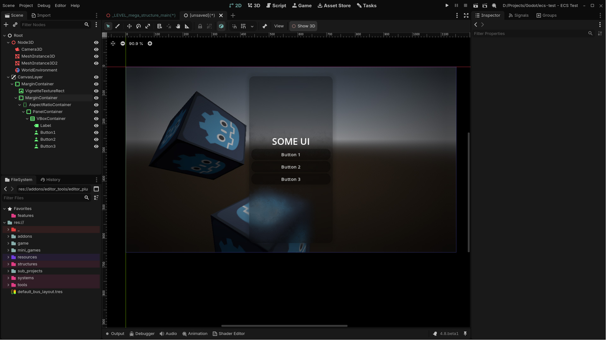

# Hybrid Workspace

Godot 4 editor plugin to view 3D inside the 2D editor and via verse.

## Features

- The "Show 2D" button in the spatial editor menu toggles the 2D inside the 3D editor
- The "Show 3D" button in the canvas editor menu toggles the 3D inside the 2D editor

